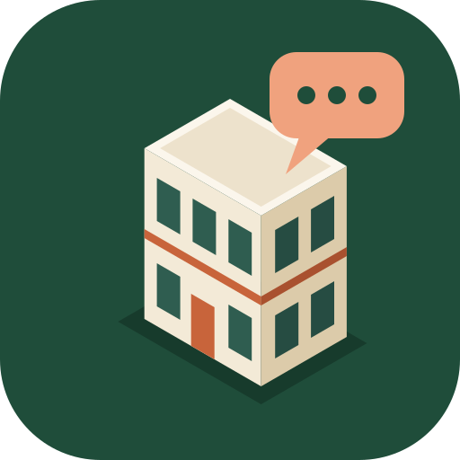
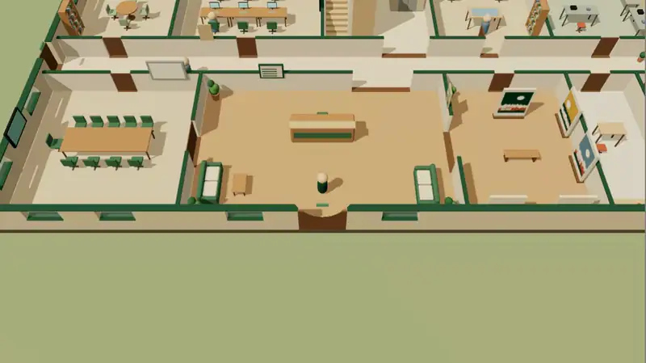
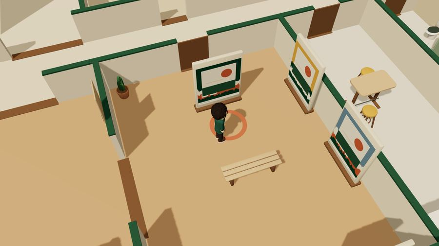
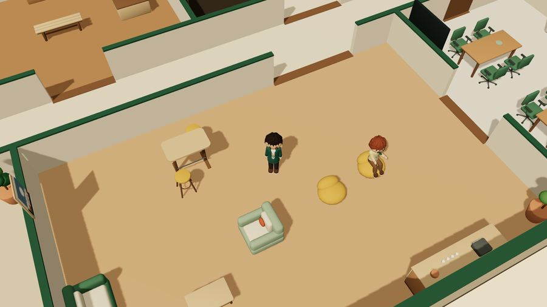
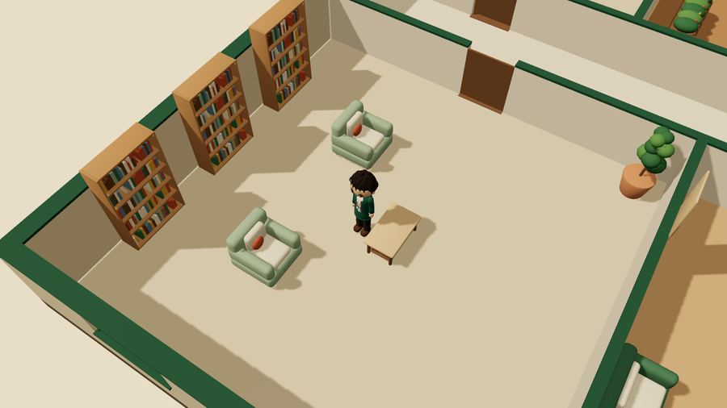

<p align="center"></p>

<h1 align="center">kantor-rpg</h1>

<p align="center">
Kantor virtual dua lantai yang berjalan di browser. Gedungnya bisa dijelajahi, agen tim AI-nya bisa diajak bicara, dan gambar kerjanya bisa dicetak.
</p>

<p align="center">
<a href="https://employee-rpg.air-buddy.site"><b>Coba demo</b></a> ·
<a href="docs/FITUR.md">Semua fitur</a> ·
<a href="INSTALL.md">Pasang sendiri</a> ·
<a href="LICENSE">Lisensi MIT</a>
</p>

<p align="center"></p>

Kamu bermain sebagai CEO di gedung dua lantai yang dibangun dari satu berkas data, `design/world.json`. Dari berkas yang sama, skrip di repo ini menghasilkan model 3D Blender, 15 sheet gambar CAD, rancangan jaringan, dan dunia yang kamu jelajahi di browser. Geser satu ruang di dataset, lalu bangun ulang: denah, model, dan game ikut berubah.

Delapan karakter NPC menjalani hari mereka sendiri: kerja di meja, bikin kopi, main biliar, membaca di perpustakaan. Kalau backend privat dipasang, setiap karakter tersambung ke agen AI sungguhan. Karakter itu duduk dan mengetik saat agennya bekerja, dan kamu bisa memberinya tugas lewat chat yang sinkron dengan Telegram.

Demo publik berjalan tanpa login. Isinya simulasi dengan seed tetap, jadi setiap pengunjung melihat hari yang sama.

## Angka

| | |
|---|---|
| Gedung | 2 lantai, 38 ruang, 46 pintu, 39 jendela |
| Isi | 201 perabot dan perangkat, 54 model GLB perabot, 118 slot aktivitas NPC |
| Karakter | 9 karakter original (1 avatar pemain, 8 NPC), dimodelkan di Blender |
| Gambar kerja | 15 sheet arsitektur, interior, dan ICT dalam DWG, DXF, dan PDF |
| Unduhan JavaScript | three.js 169 kB + app 65 kB (gzip) |
| Tes | 127 tes unit, 198 skenario E2E (desktop, tablet, HP), 423 tes Python, 23 tes server |
| Keputusan tercatat | 17 ADR di [docs/decisions.md](docs/decisions.md) |

## Jelajahi gedungnya


**Lantai 1 untuk kerja dan tamu.** Lobby dengan meja resepsi, ruang rapat besar, galeri karya, pantry, ruang implementasi dengan meja denah, area kerja per peran, lab, dan ruang server.

| Ruang rapat | Galeri | Ruang implementasi |
|---|---|---|
|  |  |  |


**Lantai 2 untuk istirahat.** Perpustakaan, lounge dengan coffee bar, ruang game, meja biliar, ruang olahraga, taman dalam, dan balkon. Naik lewat tangga U atau lift di inti bangunan.

| Ruang game | Biliar | Olahraga |
|---|---|---|
|  |  |  |

| Lounge | Perpustakaan | Taman dalam |
|---|---|---|
|  |  |  |

Dinding yang menghalangi pandangan dipotong otomatis, jadi avatar selalu terlihat dari sudut kamera mana pun. Pintu terbuka sendiri saat avatar atau NPC mendekat.

## Karakter yang hidup


- **Simulasi berseed.** Seed yang sama (`?seed=20261001`) menghasilkan urutan kegiatan yang sama. Demo bisa diulang persis, dan tes E2E memeriksanya.
- **Tidak saling tabrak.** NPC memesan kursi sebelum duduk dan saling memberi jalan di koridor. NPC yang tersangkut memilih tujuan lain.
- **Status kerja nyata.** Dengan backend, karakter yang agennya sedang bekerja meninggalkan kegiatan santai, duduk di mejanya, dan labelnya berubah menjadi `bekerja` atau `menunggu keputusanmu`.
- **Bisa disapa.** Menyapa NPC membuka profil, ruang utama, kegiatan saat ini, dan potongan dialog. Pemilik mendapat tombol untuk langsung memberi tugas.

Kamu juga bisa ikut bersantai. Mesin kopi, meja biliar, konsol game, dan alat olahraga bisa dipakai. Kalau tempatnya sedang dipakai NPC, app memberi tahu siapa yang memakainya.

## Chat dengan agen

| Chat agen | Papan kerja tim |
|---|---|
|  |  |

Chat di dalam app adalah percakapan Telegram yang sama, bukan salinan. Pesan dari app melanjutkan sesi Telegram agen itu, dan balasannya muncul di kedua tempat.

- Indikator mengetik, centang terkirim dan dibaca, nada pesan masuk, jumlah pesan belum dibaca di judul tab.
- Foto, berkas, dan pesan suara yang direkam langsung dari app, sampai 10 MB per lampiran. Suara diubah menjadi teks di server sendiri.
- Agen bisa menutup balasan dengan tiga pilihan. Satu ketukan mengirim pilihan itu.
- Pesan yang menyentuh aksi berisiko (deploy, hapus data, biaya, kirim ke klien, akses) ditahan sampai pemilik menyetujuinya. Persetujuan kedaluwarsa dalam 15 menit dan hanya berlaku untuk tugas itu.
- Pesan yang tampak berisi sandi, OTP, token, atau nomor kartu ditolak sebelum dikirim.
- Papan kerja menampilkan handoff antar-agen, daftar pekerjaan, dan log aktivitas. Handoff yang tertahan lebih dari 24 jam ditandai perlu perhatian.
- Notifikasi push saat tab tertutup, dan app bisa dipasang di layar utama HP sebagai PWA.

Chat dan papan kerja hanya aktif untuk pemilik yang login dengan sandi dan kode 2FA. Pengunjung demo melihat data simulasi berlabel.

## Tata ulang kantornya


**Office Studio** membuka denah dari atas untuk memindah, memutar, menambah, dan menghapus perabot, dengan grid 0,25 m.

- Setiap perubahan divalidasi: perabot tidak boleh menembus dinding, menghalangi ayunan pintu, bertabrakan, atau memutus jalan ke ruang dan tangga mana pun. Publish ditolak kalau ada yang dilanggar.
- Outlet data yang menempel di perabot ikut pindah, dan panel menghitung outlet yang pindah, hilang, dan baru.
- Undo dan redo, simpan draft, publish lokal, rollback sampai 5 versi, ekspor dan impor JSON.

**Avatar Studio** mengganti gaya rambut dan palet pakaian avatar, dengan pratinjau 3D dan animasi jalan, melambai, bicara, duduk, dan mengetik.

| Avatar Studio | Direktori | Pengaturan |
|---|---|---|
|  |  |  |

## Satu dataset, banyak keluaran

| Tampak bangunan (A-301) | Topologi jaringan (ICT-001) |
|---|---|
|  |  |

`design/world.json` memuat dinding, ruang, pintu, jendela, perabot, dan titik jaringan. Dari situ:

- `tools/build_design.py` memvalidasi dataset (geometri, akses, arah keluar), menghitung kapasitas ruang, membuat jadwal ruang, peta port ICT, dan matriks kebutuhan.
- `cad/generate.py` menulis 15 sheet: denah, jadwal ruang, layout perabot, tampak, potongan, finish interior, topologi jaringan, outlet per lantai, rak, jalur kabel, dan jadwal port. Keluarannya DXF dalam milimeter dan PDF vektor. DWG dibuat dan dibuka ulang di AutoCAD, dengan log di `docs/evidence/`.
- `blender/` membangun gedung, perabot, dan karakter, mengekspor GLB, lalu membukanya ulang untuk memastikan hasilnya valid.
- App membaca dataset yang sama saat runtime, jadi dunia 3D cocok dengan gambar kerja.

## Main di mana saja


- **Desktop.** WASD atau panah untuk berjalan, Shift lari, Q/Z putar kamera, R luruskan kamera, +/- zoom, E interaksi, H bantuan.
- **HP dan tablet.** Joystick di kiri bawah, tombol Lari dan Aksi, seret layar untuk memutar kamera. Menu atas tersusun dalam grid di layar sempit.
- **Tanpa WebGL.** App berpindah ke mode direktori yang tetap menampilkan ruang dan karakter.
- **Aksesibilitas.** Tema terang dan gelap, mode kurangi gerak, kualitas grafis ringan untuk perangkat lama, label pembaca layar, dan semua dialog bisa dipakai dengan keyboard. Kontras warna diperiksa otomatis, dan halaman diuji dengan axe.

Model 3D diaudit supaya tidak ada permukaan yang berkedip (z-fighting). Tes `app/tests/unit/coplanar.test.ts` gagal kalau ada permukaan beda warna yang kembali menempel. Perbaikan terakhir menurunkan titik kedip dari 12.908 ke 2.689 di 33 skenario kamera ([laporan](docs/evidence/AUDIT-3D/LAPORAN.md)).

<br clear="right">

## Mulai dalam satu menit

```bash
git clone https://github.com/air-buddy410/kantor-rpg.git
cd kantor-rpg/app
npm ci
npm run dev        # buka http://localhost:5173
```

Itu sudah cukup untuk dunia 3D, NPC, Studio, dan semua fitur pengunjung. Build produksi, nginx, backend chat, notifikasi push, dan masalah umum dijelaskan di **[INSTALL.md](INSTALL.md)**.

## Teknologi

- **App:** TypeScript, Vite, three.js. Tanpa framework UI.
- **Backend:** Node.js tanpa framework, satu proses, data di SQLite bawaan Node. Login sandi dan TOTP, sesi bercookie dengan CSRF, Web Push dengan VAPID.
- **3D:** Blender 4 lewat skrip Python. GLB dioptimasi dengan meshopt dan kuantisasi mesh.
- **CAD:** generator DXF di Python, PDF vektor, DWG lewat AutoCAD.
- **Tes:** vitest, Playwright, pytest, `node:test`.

## Struktur repo

| Folder | Isi |
|---|---|
| `app/` | App 3D, tes unit (vitest) dan E2E (Playwright) |
| `server/` | Backend privat: auth, chat agen, push, lampiran |
| `design/` | Dataset dunia, karakter, dialog, dan kebutuhan; sumber semua artefak |
| `blender/` | Skrip dan berkas `.blend` untuk gedung, karakter, perabot |
| `cad/`, `drawings/` | Generator DXF/DWG dan PDF gambar kerja |
| `tools/` | Build desain, validator dunia, audit GLB, probe kedip 3D |
| `PRD/` | Kebutuhan produk, versi terbaru [PRD v1.1](PRD/PRD-v1.1.md) |
| `docs/` | Fitur, keputusan (ADR), laporan QA, bukti uji, runbook |

## Tes

```bash
cd app
npx tsc --noEmit
npx vitest run           # termasuk gate z-fighting
npx playwright test      # desktop, tablet, HP
cd ../server && npm ci && npm test
```

Membangun ulang semua artefak desain dari clone bersih dijelaskan di [docs/REBUILD.md](docs/REBUILD.md):

```bash
pip install -r requirements-dev.txt
python3 tools/build_design.py
python3 -m pytest tests/py -q
```

## Dokumen

- [Semua fitur, dijelaskan satu per satu](docs/FITUR.md)
- [Panduan pemasangan](INSTALL.md)
- [Cara berkontribusi](CONTRIBUTING.md)
- [Keputusan arsitektur](docs/decisions.md), ADR-001 sampai ADR-017
- [Laporan QA](docs/QA-REPORT.md) dan [daftar tes yang dilewati](docs/SKIP-LEDGER.md)
- [Audit 3D: z-fighting dan kedip](docs/evidence/AUDIT-3D/LAPORAN.md)
- [Validasi perangkat](docs/DEVICE-VALIDATION.md)

## Lisensi

[MIT](LICENSE) untuk seluruh isi repo: kode, model 3D, karakter, gambar kerja, dan dokumentasi. Boleh dipakai, diubah, dan dijual, asalkan pemberitahuan hak cipta tetap disertakan.

Semua karakter dan aset dibuat khusus untuk proyek ini. Komponen pihak ketiga di dalam app memakai lisensinya sendiri: three.js (MIT) dan huruf Alegreya Sans (SIL OFL 1.1). Salinannya ada di `app/public/licenses/`.
