# Fitur Kantor RPG

Dokumen ini menjelaskan setiap fitur dari sisi pemakai: apa yang terlihat, cara memakainya, dan batasnya. Untuk pemasangan lihat [INSTALL.md](../INSTALL.md).

Daftar isi

1. [Dua mode: pengunjung dan pemilik](#1-dua-mode-pengunjung-dan-pemilik)
2. [Dunia 3D](#2-dunia-3d)
3. [Bergerak dan kamera](#3-bergerak-dan-kamera)
4. [Interaksi dan aktivitas](#4-interaksi-dan-aktivitas)
5. [Karakter NPC](#5-karakter-npc)
6. [Direktori](#6-direktori)
7. [Avatar Studio](#7-avatar-studio)
8. [Office Studio: menata ulang perabot](#8-office-studio-menata-ulang-perabot)
9. [Papan kerja tim](#9-papan-kerja-tim)
10. [Chat agen](#10-chat-agen)
11. [Persetujuan aksi berisiko](#11-persetujuan-aksi-berisiko)
12. [Notifikasi push dan aplikasi terpasang](#12-notifikasi-push-dan-aplikasi-terpasang)
13. [Login pemilik](#13-login-pemilik)
14. [Pengaturan dan aksesibilitas](#14-pengaturan-dan-aksesibilitas)
15. [Gambar kerja dan dataset](#15-gambar-kerja-dan-dataset)
16. [Parameter URL](#16-parameter-url)
17. [Privasi dan data](#17-privasi-dan-data)

---

## 1. Dua mode: pengunjung dan pemilik

App punya dua lapis yang sengaja dipisah.

| | Pengunjung (tanpa login) | Pemilik (login sandi + 2FA) |
|---|---|---|
| Dunia 3D, NPC, direktori, studio | Ya | Ya |
| Status NPC | Simulasi | Status kerja nyata dari agen, bila ada |
| Papan kerja | Data contoh berlabel `Demo` | Data nyata, baca-saja |
| Chat agen | Hanya form login | Chat dan memberi tugas |
| Notifikasi push | Tidak | Ya |

Label oranye `SIMULASI: data demo` di bagian atas layar menandai bahwa yang terlihat bukan data nyata. Pengunjung tidak bisa mengirim apa pun ke agen.

Fitur pemilik membutuhkan backend privat (`server/`). Tanpa backend, app tetap berjalan penuh dalam mode pengunjung.

## 2. Dunia 3D

- Dua lantai: **Lantai 1 (kerja dan kunjungan)** dan **Lantai 2 (rekreasi)**, total 38 ruang, 46 pintu, 39 jendela, dan 201 perabot serta perangkat.
- Lantai 1 berisi lobby dan resepsi (titik awal), ruang rapat besar, galeri, pantry, ruang diskusi, ruang implementasi, area kerja per peran, lab, ruang server, riser, dan gudang.
- Lantai 2 berisi perpustakaan, lounge dan coffee bar, ruang makan, shower, ruang game, ruang biliar, ruang olahraga, taman dalam, dan balkon.
- Pindah lantai lewat **tangga U** atau **lift** di inti bangunan. Tangga darurat luar hanya penanda konsep dan tidak bisa dipakai.
- Dinding yang menghalangi pandangan dipotong otomatis (cutaway), termasuk jendela dan daun pintu, sehingga avatar selalu terlihat.
- Pintu terbuka sendiri saat avatar atau NPC mendekat. Ruang berakses terbatas terkunci dalam mode visitor (lihat bagian 14).
- Label ruang dan karakter disembunyikan bila tertutup menu, joystick, atau petunjuk interaksi, agar teks tidak saling tumpuk.

| Lobby | Ruang rapat | Tangga U |
|---|---|---|
| 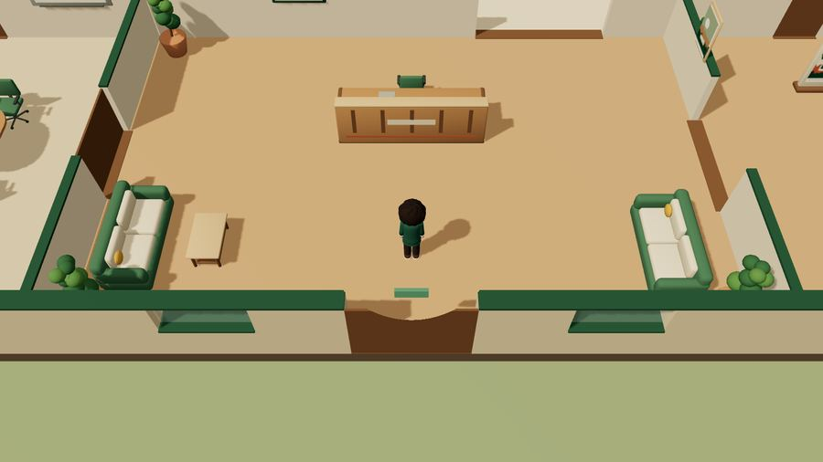 | 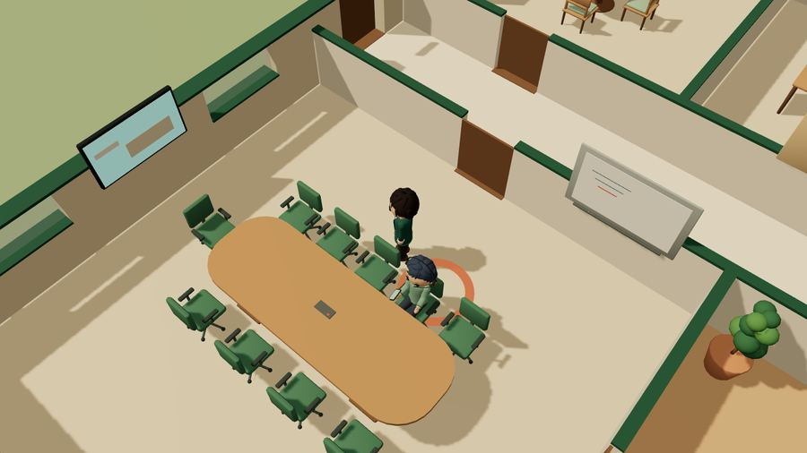 |  |

| Ruang game | Biliar | Ruang olahraga |
|---|---|---|
| 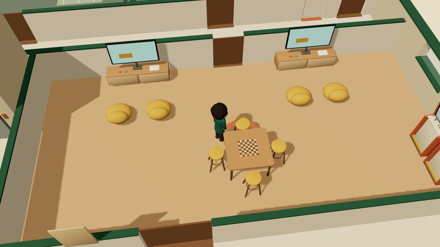 | 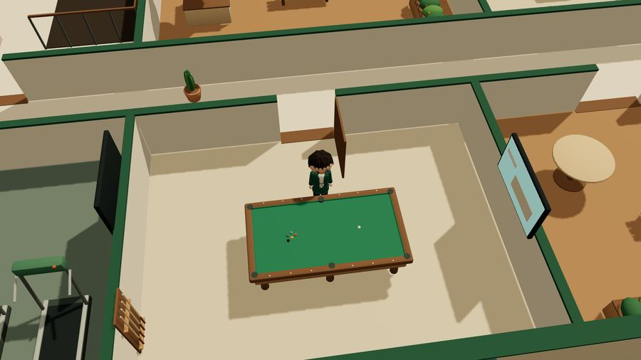 |  |

Model GLB dibuat di Blender. Permukaan yang menempel diberi jarak beberapa milimeter saat dimuat, sehingga tidak ada kedip (z-fighting). Tes `app/tests/unit/coplanar.test.ts` gagal bila ada permukaan beda warna yang kembali menempel.

## 3. Bergerak dan kamera

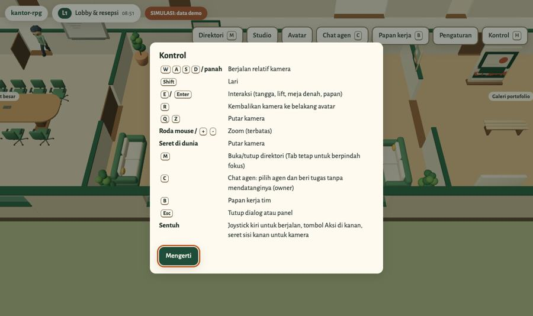

Tekan **H** atau tombol **Kontrol** untuk melihat daftar ini di dalam app.

| Tombol | Fungsi |
|---|---|
| W A S D / panah | Berjalan, arahnya relatif terhadap kamera |
| Shift | Lari |
| E / Enter | Interaksi dengan objek atau karakter terdekat |
| R | Kembalikan kamera ke belakang avatar |
| Q / Z | Putar kamera |
| Roda mouse / + / - | Zoom (ada batas dekat dan jauh) |
| Seret di dunia | Putar kamera |
| M | Buka atau tutup direktori |
| C | Chat agen (pemilik) |
| B | Papan kerja tim |
| Esc | Tutup dialog atau panel |

**Di HP dan tablet**

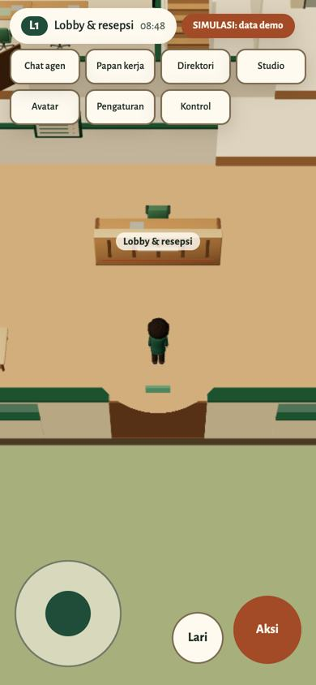

- Joystick di kiri bawah untuk berjalan. Mendorong joystick sampai tepi membuat avatar berlari.
- Tombol **Lari** menyalakan atau mematikan lari.
- Tombol **Aksi** sama dengan E.
- Seret sisi kanan layar untuk memutar kamera.
- Menu atas tersusun dalam grid agar semua tombol muat di layar sempit.

Avatar tidak bisa menembus dinding, perabot, atau NPC. Bila posisi avatar tidak valid (misalnya setelah perabot dipindah), avatar dikembalikan ke titik aman terdekat.

## 4. Interaksi dan aktivitas

Saat avatar dekat dengan sesuatu yang bisa dipakai, muncul petunjuk di bawah layar, misalnya `E: Pakai tangga ke Lantai 2`. Objek yang bisa dipakai:

| Objek | Aksi |
|---|---|
| Tangga dan lift | Pindah lantai |
| Meja denah | Membaca denah dan rancangan ICT |
| Papan direktori | Membuka direktori |
| Papan di dinding | Membuka Papan Handoff, Daftar Pekerjaan, atau Log Aktivitas |
| Karya di galeri | Melihat karya |
| Mesin kopi | Bikin kopi |
| Meja biliar | Main biliar: tiap pukulan acak, skor hanya selama sesi |
| Konsol game | Main game per ronde, tanpa skor tersimpan |
| Alat olahraga | Olahraga |
| Karakter NPC | Menyapa, lalu membuka profil dan dialog |

Aktivitas di atas adalah aktivitas virtual. Aktivitas itu tidak mengubah status kerja siapa pun. Bila tempatnya sedang dipakai NPC, app memberi tahu siapa yang memakainya. Tombol **Selesai** atau E mengakhiri aktivitas.

## 5. Karakter NPC

- Ada sembilan karakter original: satu avatar pemain (CEO) dan delapan persona NPC dengan peran berbeda, misalnya supervisor, desain, spesifikasi ICT, instalasi jaringan, materi visual, review dan QA.
- NPC memilih kegiatan sendiri: kerja di meja, bikin kopi, ngobrol, membaca, peregangan, main game, biliar, olahraga, atau istirahat. Pilihan diambil dari 118 slot aktivitas di dunia.
- Simulasi memakai seed tetap (`?seed=20261001` secara bawaan). Seed yang sama menghasilkan urutan kegiatan yang sama, jadi demo bisa diulang.
- NPC saling memberi jalan dan memesan kursi sebelum duduk sehingga tidak saling tumpang tindih. NPC yang tersangkut memilih tujuan lain.
- Jam di HUD (`08:53`) adalah jam simulasi, bukan jam sebenarnya.
- Label di atas kepala memperlihatkan nama dan kegiatan, misalnya `Echo · ngobrol`.

**Status kerja nyata (pemilik).** Bila agen di balik sebuah karakter sedang mengerjakan tugas, karakter itu berhenti bersantai, duduk di mejanya, dan mengetik. Labelnya berubah menjadi `<nama> · bekerja` atau `<nama> · menunggu keputusanmu`. Status ini diambil dari backend tiap 10 detik (30 detik bila tab tidak aktif). Dialog dan aktivitas santai tetap fiksi.

Menyapa NPC membuka panel profil: peran, ruang utama, kegiatan saat ini, jam simulasi, dan potongan dialog. Tombol **Topik lain** mengganti dialog. Pemilik juga mendapat tombol **Bicara & beri tugas**.

## 6. Direktori

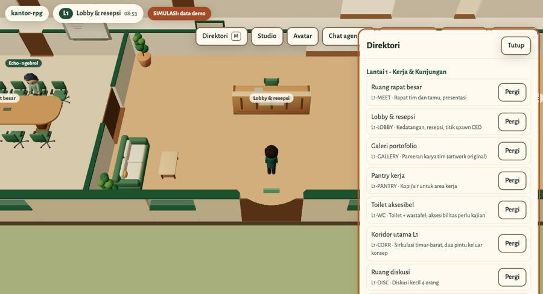

Tekan **M** atau tombol **Direktori**. Isinya:

- Daftar ruang per lantai dengan kode, fungsi, dan tombol **Pergi**. Avatar berjalan sendiri ke ruang itu. Ruang yang terkunci diberi tanda `terkunci` beserta alasannya.
- Daftar persona dengan tombol **Profil**, **Temui** (berjalan ke karakter itu), dan **Beri tugas** (pemilik).
- Agen yang belum punya karakter di dunia tetap bisa diberi tugas dari sini.
- Pintasan ke tiga tab papan kerja.
- Tautan ke dokumen proyek.

Bila browser tidak mendukung WebGL, direktori menjadi tampilan utama. Tombol **Pergi** berubah menjadi **Info**.

## 7. Avatar Studio

Tombol **Avatar** membuka pratinjau 3D avatar pemain.

- Rambut: pendek berjambul, disisir ke samping, atau jabrik lembut.
- Palet pakaian: hijau hutan, terakota, atau oat dan kayu.
- Pratinjau animasi: diam, jalan, melambai, bicara, duduk, mengetik.
- **Simpan** menyimpan pilihan di browser ini. **Reset ke default** mengembalikan tampilan awal.

Hanya varian yang benar-benar ada di model yang ditampilkan.

## 8. Office Studio: menata ulang perabot

Tombol **Studio** membuka denah dari atas untuk memindahkan perabot.

**Mengedit**

- Pilih perabot dari daftar atau klik di denah.
- Geser dengan panah (grid 0,25 m), putar 90 derajat dengan R, hapus dengan Delete.
- Tambah perabot baru dari daftar tipe.
- Undo dan redo: Ctrl+Z dan Ctrl+Y. Esc membatalkan pilihan.
- Perangkat ICT yang menempel pada perabot (outlet data) ikut pindah atau terhapus. Panel menampilkan jumlah outlet yang pindah, dihapus, dan baru.

**Validasi.** Setiap perubahan diperiksa, dan publish ditolak bila salah satu aturan dilanggar:

- Perabot keluar dari ruang atau menembus dinding.
- Dua perabot bertabrakan, atau masuk area bebas perabot lain.
- Perabot menghalangi pintu atau area ayun daun pintu.
- Ada ruang, slot aktivitas, atau ujung tangga yang tidak lagi bisa dicapai.

**Menyimpan**

| Tombol | Hasil |
|---|---|
| Simpan draft | Disimpan di browser; muncul lagi saat Studio dibuka |
| Publish lokal | Layout dipakai di dunia, hanya di browser ini |
| Rollback | Kembali ke publish sebelumnya (sampai 5 versi) |
| Kembali ke dataset | Membuang layout lokal, memakai `world.json` |
| Export JSON | Mengunduh layout untuk diproses ulang |
| Import JSON | Memuat layout (maks 512 KB); file tidak valid ditolak tanpa mengubah layout |

Studio tidak pernah mengubah repo atau server. Untuk memakai layout baru secara permanen, ekspor JSON lalu hitung ulang port map dengan `tools/ict_derive.py --layout`.

## 9. Papan kerja tim

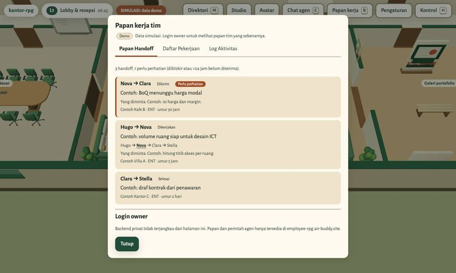

Tekan **B**, tombol **Papan kerja**, atau dekati papan di dinding. Ada tiga tab:

- **Papan Handoff**: serah terima pekerjaan antar-agen dalam 7 hari terakhir. Tiap kartu memperlihatkan pengirim dan penerima, judul, apa yang diminta, rantai kerja, proyek, dan umurnya. Handoff yang diblokir atau belum diterima lebih dari 24 jam diberi tanda `Perlu perhatian`.
- **Daftar Pekerjaan**: tugas yang sedang berjalan, menunggu, diblokir, dan selesai, diurutkan dari yang paling butuh perhatian.
- **Log Aktivitas**: kejadian 24 jam terakhir, misalnya tugas dibuat, diambil, selesai, atau diblokir.

Papan bersifat baca-saja: perubahan tugas tetap dilakukan lewat agen. Bagian atas papan menunjukkan kapan data terakhir diamati. Bila sumber data gagal dibaca, papan menampilkan peringatan dan data terakhir yang berhasil, bukan daftar kosong.

## 10. Chat agen

Tekan **C** atau tombol **Chat agen** untuk membuka daftar agen. Tiap agen memperlihatkan perannya dan status: `Bekerja`, `Menunggu kamu`, `Siap`, atau `mengetik…`. Chat juga bisa dibuka dari profil karakter atau dari direktori.

**Sinkron dengan Telegram.** Bila agen punya percakapan Telegram dengan pemilik, chat di app berisi percakapan yang sama:

- Riwayat diambil dari sesi Telegram agen itu, lengkap dengan label asal (Telegram, dari RPG, sistem) dan jam.
- Pesan dari app melanjutkan sesi Telegram yang aktif, bukan membuat sesi baru.
- Balasan agen juga dikirim ke Telegram dengan label `Dari kantor RPG`.
- Pesan dari Telegram dan dari app yang datang bersamaan diantrikan, tidak saling menimpa.

Agen yang belum punya percakapan Telegram memakai percakapan khusus app, dan panelnya menyebutkan hal itu.

**Rasa seperti aplikasi chat**

- Status `sedang mengetik…` selama agen mengerjakan pesan (maksimal 10 menit, agar agen yang macet tidak terlihat mengetik terus).
- Centang: satu centang berarti diterima server, dua centang berarti diterima agen, dua centang biru berarti agen sudah membalas.
- `aktif X menit lalu` dihitung dari balasan terakhir agen.
- Pemisah tanggal (Hari ini, Kemarin, atau tanggal).
- Tombol **Balas** (mengutip pesan) dan **Salin** di tiap pesan.
- Nada pendek saat pesan baru masuk selama halaman terbuka (bisa dimatikan di pengaturan notifikasi), dan judul tab memperlihatkan jumlah pesan belum dibaca.
- **Cari pesan** di dalam percakapan.
- **Mulai percakapan baru** untuk memulai sesi baru.

**Pilihan balasan.** Agen bisa menutup balasannya dengan tiga pilihan. Mengetuk satu pilihan mengirim pesan yang sesuai. Pilihan hanya berlaku selama balasan itu masih yang terbaru; setelah ada pesan baru, pilihan lama ditandai `Pilihan di giliran ini sudah tidak berlaku`.

**Lampiran dan suara**

- Foto (JPG, PNG, WebP, GIF) dan berkas (PDF, TXT, CSV, DOCX, XLSX, ZIP), maksimal 10 MB per berkas dan 5 lampiran per pesan. Foto bisa ditempel atau diseret ke kolom pesan.
- Pesan suara direkam di browser, lalu diubah menjadi teks secara lokal di server (maksimal 180 detik) sebelum dikirim ke agen.
- Isi berkas diperiksa sesuai tipenya; berkas yang tidak cocok dengan ekstensinya ditolak.

**Batas pesan**

- Maksimal 4.000 karakter per pesan dan 5 tugas antre per agen.
- Pesan yang tampak berisi sandi, OTP, token, kunci API, atau nomor kartu ditolak sebelum dikirim.
- Ctrl/⌘ + Enter mengirim, Esc menutup tanpa mengirim.
- Pesan yang sama tidak terkirim dua kali bila tombol kirim ditekan ulang.
- Tugas yang masih berjalan bisa dibatalkan.

## 11. Persetujuan aksi berisiko

Sebelum diteruskan ke agen, setiap pesan dicocokkan dengan daftar kategori berisiko:

- perangkat atau sistem jaringan produksi,
- server: restart, VM, atau upgrade,
- menghapus atau mereset data,
- deploy atau merge ke produksi,
- biaya atau pembayaran,
- mengirim sesuatu ke klien,
- kredensial atau hak akses.

Pesan yang cocok ditahan dengan status `Menunggu persetujuan`. Panel memperlihatkan aksi, dampak, dan jalan mundurnya. Pemilik harus menekan **Setujui untuk tugas ini** dalam 15 menit. Persetujuan hanya berlaku untuk tugas itu, tidak untuk tugas berikutnya.

## 12. Notifikasi push dan aplikasi terpasang

- Tombol **Aktifkan notifikasi** meminta izin browser, lalu mengirim notifikasi uji. Izin tidak diminta tanpa tombol ini.
- Notifikasi berisi nama agen dan potongan balasan (maksimal 120 karakter). Mengetuk notifikasi membuka chat agen itu.
- Notifikasi bisa dibisukan per agen per perangkat.
- Push memakai standar Web Push (RFC 8291 dan VAPID) langsung dari backend sendiri, tanpa layanan pihak ketiga berbayar. Alamat tujuan hanya layanan push resmi browser.
- App bisa dipasang ke layar utama HP sebagai PWA (`manifest.webmanifest` dan service worker). Di iPhone, notifikasi hanya bekerja bila app dibuka dari layar utama.

## 13. Login pemilik

- Login memakai sandi dan kode 2FA 6 digit dari aplikasi authenticator.
- Akun dibuat sekali lewat tautan setup sekali pakai. Sandi disimpan dalam bentuk hash, dan rahasia 2FA tidak pernah dikirim ke browser.
- Sandi salah, kode salah, atau kode yang sudah dipakai ditolak. Lima kali gagal dalam 15 menit mengunci login sementara.
- Sesi berlaku 12 jam. **Keluar** mematikan sesi di server.
- Permintaan yang mengubah data wajib membawa token CSRF dan berasal dari origin situs.
- Backend hanya menerima permintaan yang melewati proxy nginx dengan header rahasia. Permintaan langsung ditolak.

## 14. Pengaturan dan aksesibilitas

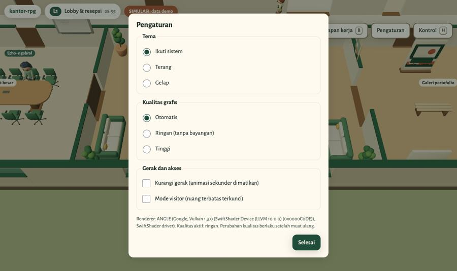

| Pengaturan | Pilihan |
|---|---|
| Tema | Ikuti sistem, terang, gelap |
| Kualitas grafis | Otomatis, ringan (tanpa bayangan), tinggi. Otomatis memilih ringan bila browser memakai renderer software |
| Kurangi gerak | Mematikan animasi sekunder. Bawaannya mengikuti pengaturan sistem |
| Mode visitor | Mengunci ruang berakses terbatas (ruang server, riser, shaft). Avatar dipindah ke titik aman bila sedang berada di sana |

Pengaturan disimpan di browser.

Aksesibilitas:

- Semua dialog bisa dipakai dengan keyboard; Tab berpindah fokus, Esc menutup.
- Tombol punya label untuk pembaca layar, dan pengumuman penting dibacakan lewat `aria-live`.
- Kontras warna diperiksa otomatis, dan halaman diuji dengan axe tanpa pelanggaran.
- Bila WebGL tidak ada, app tetap bisa dipakai lewat direktori (lihat bagian 6).

## 15. Gambar kerja dan dataset

Semua artefak dibuat dari satu sumber, `design/world.json`. Bila dataset berubah, gambar, model 3D, dan app ikut berubah saat dibangun ulang.

| Tampak bangunan (A-301) | Topologi jaringan (ICT-001) |
|---|---|
| 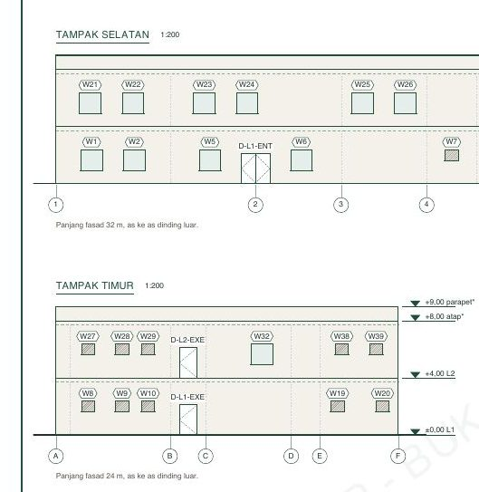 | 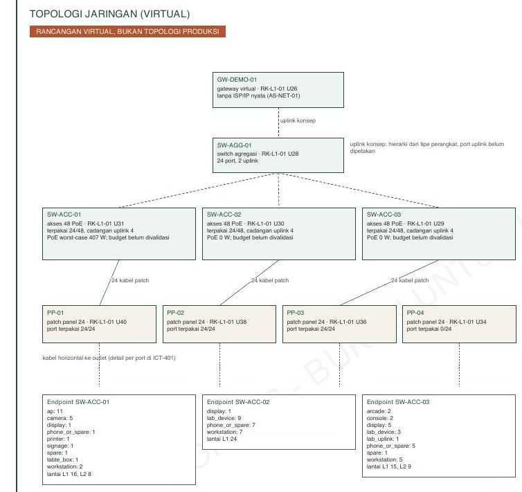 |

| Kode | Isi |
|---|---|
| A-001 | Cover, indeks, dan catatan umum |
| A-101, A-102 | Denah Lantai 1 dan Lantai 2 |
| A-103 | Room schedule, pintu, dan jendela |
| A-201, A-202 | Layout perabot Lantai 1 dan Lantai 2 |
| A-301 | Tampak |
| A-401 | Potongan |
| I-101 | Finish interior dan material |
| ICT-001 | Topologi jaringan |
| ICT-101, ICT-102 | Outlet, access point, dan kamera per lantai |
| ICT-201 | Elevasi rack |
| ICT-301 | Pathway dan riser |
| ICT-401 | Port dan device schedule |

- PDF per sheet dan gabungan ada di `drawings/pdf/`; DXF dan DWG di `cad/out/`.
- Model Blender (`blender/out/*.blend`) dan GLB untuk app (`app/public/assets/`).
- Rancangan ICT bersifat virtual: contoh perencanaan, bukan instalasi nyata.
- Cara membangun ulang: [docs/REBUILD.md](REBUILD.md).

## 16. Parameter URL

| Parameter | Fungsi |
|---|---|
| `?seed=<angka>` | Seed simulasi NPC (bawaan 20261001) |
| `?nogl=1` | Paksa mode tanpa WebGL (direktori) |
| `?chat=<agen>` | Langsung membuka chat agen tertentu (dipakai notifikasi) |
| `?perf=route&seconds=60&report=1` | Rute uji performa otomatis lalu tampilkan laporan FPS |
| `?a11ylog=1` | Catat pengumuman aksesibilitas untuk uji pembaca layar |

## 17. Privasi dan data

- Mode pengunjung tidak mengirim data ke server selain memuat halaman dan aset.
- Pengaturan, avatar, draft, dan layout Studio hanya tersimpan di browser.
- Backend menyimpan pesan 30 hari dan log audit 90 hari, di folder data dengan izin 0700.
- Ringkasan status kerja yang ditampilkan di NPC disaring dan dipotong maksimal 70 karakter. Profil agen yang ditandai pribadi tidak pernah muncul.
- Token bot dan rahasia lain hanya ada di server, tidak pernah dikirim ke browser.

---

Kantor RPG dirilis di bawah [lisensi MIT](../LICENSE).
